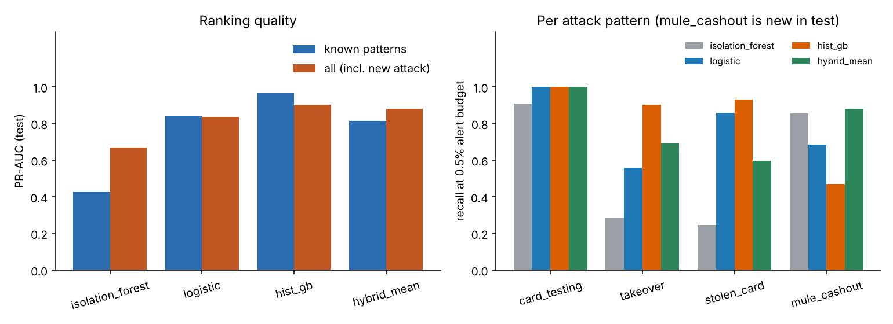

# fraud-detection-sklearn

Card-fraud detection with **scikit-learn**, evaluated the way a payments team would judge it:
on a **later time period**, with a **review budget**, in **złoty**, and against an attack that
**did not exist in the training data**.

Part of a three-repository comparison on identical data and protocol:
**scikit-learn** (this repo) · [Keras](https://github.com/Volers321/fraud-detection-keras) · [TensorFlow](https://github.com/Volers321/fraud-detection-tensorflow).



## Why this is not another Kaggle notebook

| Common shortcut | What this repo does instead |
|---|---|
| random train/test split | temporal split: train days 0-59, validation 60-74, test 75-89 |
| accuracy / ROC-AUC on 0.5% fraud | PR-AUC, recall and precision at a **0.5% alert budget** |
| features from the whole table | features of a transaction use **only earlier transactions of the same card**; a test proves that removing future rows changes nothing |
| threshold 0.5 | threshold fixed on validation, applied unchanged to test |
| one number | confidence intervals from a **card-level bootstrap**, per-pattern recall, ablations |
| ignore money | net savings = stopped fraud amount minus 5 PLN per reviewed alert |
| assume the future looks like the past | a **new attack** (`mule_cashout`) appears only in the test period |

## Data

Synthetic, from a simulator in `src/fraudsk/data.py` (no bank data, no real fraud rates).
2,500 cards, 90 days, **208,206 transactions, 0.51% fraud**. Cards have home city, typical amount,
time-of-day habits, favourite categories, one or two devices. Honest traffic includes hard
negatives (trips far from home, a new phone, rare large purchases).

| Pattern | Rows | Signature |
|---|---:|---|
| `takeover` | 336 | new device, large amount, night, foreign IP |
| `stolen_card` | 329 | physical use far from home, several payments in a row |
| `card_testing` | 282 | burst of tiny online payments from a new device |
| `mule_cashout` | 117 | series of ATM withdrawals; **only after day 76** (test period) |

Fraud rows: 613 train, 181 validation, 270 test.

## Results (test period, 34,556 transactions, 270 fraud)

Alert threshold = the validation score that alarms 0.5% of transactions. Brackets: 95% CI, card bootstrap.

| Model | PR-AUC all | PR-AUC known patterns | Recall | Precision | Alert rate | Net savings (PLN) | Fraud amount stopped |
|---|---:|---:|---:|---:|---:|---:|---:|
| Isolation Forest (no labels) | 0.668 | 0.429 | 0.626 | 0.581 | 0.84% | 172,555 | 78.5% |
| Logistic regression | 0.836 | 0.842 | 0.748 | 0.852 | 0.69% | 152,667 | 69.4% |
| **HistGradientBoosting** | **0.901** [0.842-0.948] | **0.969** | 0.737 [0.635-0.847] | **0.926** | 0.62% | 116,644 | 53.1% |
| Hybrid (mean of HGB and IF ranks) | 0.880 [0.834-0.916] | 0.815 | **0.804** [0.737-0.853] | 0.851 | 0.74% | **188,601** | **85.6%** |
| HGB + cost rule (calibrated) | - | - | 0.767 | 0.855 | 0.70% | 148,863 | 67.7% |

*Known patterns* = PR-AUC computed without the `mule_cashout` rows.

Recall by attack pattern:

| Model | card_testing | takeover | stolen_card | **mule_cashout (new)** |
|---|---:|---:|---:|---:|
| Isolation Forest | 0.91 | 0.29 | 0.25 | **0.86** |
| Logistic regression | 1.00 | 0.56 | 0.86 | 0.68 |
| HistGradientBoosting | 1.00 | 0.90 | 0.93 | **0.47** |
| Hybrid | 1.00 | 0.69 | 0.60 | 0.88 |
| HGB + cost rule | 0.57 | 1.00 | 0.98 | 0.63 |

## What the results say

1. **The best ranker is not the best money-saver.** Gradient boosting has the highest PR-AUC
   and precision, but it stops only 53% of the fraud *value*; the unsupervised Isolation Forest
   stops 78%, because it catches the large ATM cash-outs the supervised model never saw.
2. **Supervised models are blind to new attacks.** HGB finds 90-100% of the known patterns
   but only 47% of the new one. The unsupervised model finds 86% of the new one but only
   25-29% of `takeover` and `stolen_card`. Averaging their ranks recovers most of both (recall 0.80,
   net savings +62% over HGB) at the price of known-pattern PR-AUC (0.97 to 0.81).
3. **Deciding by expected cost beats a fixed budget.** Alerting when `P(fraud) x amount > 5 PLN`
   (isotonic-calibrated probabilities) lifts net savings of the same model from 116,644 to
   148,863 PLN. Side effect worth knowing: `card_testing` recall drops to 0.57 because each
   tiny test payment is not worth a review on its own, although these bursts precede real losses.
4. **Geography and device carry the model.** Ablation of HGB (PR-AUC on known patterns, 0.969 baseline):

   | Dropped feature group | PR-AUC known | What breaks |
   |---|---:|---|
   | geo (`dist_home_km`, `dist_prev_km`, `speed_kmh`) | 0.817 | stolen_card recall 0.93 to 0.39 |
   | device and IP (`new_device`, `is_foreign`) | 0.881 | takeover recall 0.90 to 0.58 |
   | velocity (counts and sums in 10 min / 1 h / 24 h) | 0.905 | takeover recall 0.90 to 0.81 |
   | card history (`amount_z`, `amount_ratio`, ...) | 0.968 | nothing measurable |

   Permutation importance on validation agrees: `dist_home_km` (-0.249 PR-AUC), `cnt_1h`, `category`, `log_amount`, `new_device`.
5. **Retraining helps slowly.** On days 83+ (76 cash-out rows) a model refreshed with labels up
   to day 77 (5-day label delay) finds 0.609 of fraud in the top 0.5% against 0.586 for the stale
   model: it had seen only ~2 days of the new attack. Labels for a new pattern arrive late, so a
   model needs a second line of defence (here: the unsupervised score) in the meantime.

## Caveats (read before quoting any number)

* **Synthetic data.** Absolute values are an artefact of the simulator. The point is the method:
  what to measure and which traps to avoid. Do not read 0.90 PR-AUC as a claim about real fraud.
* **One simulated dataset (seed 0).** The intervals describe sampling noise over cards within
  it, not variation across datasets.
* **The hybrid weights were not tuned.** The headline uses the plain mean of the two percentile
  ranks, declared before looking at results. While exploring I also tried a maximum and a 0.7/0.3
  mix on the test period; I do not report them, because choosing among them on test would be
  selection on the test set, and validation contains no new attack to choose on.
* **Net savings** counts the amount of each stopped fraud as loss avoided and ignores customer
  friction, chargeback fees and the cost of blocked genuine payments.
* Hyper-parameters (12 random draws, PR-AUC on the validation block) were tuned on validation only.

## Run it

```bash
pip install -e ".[dev]"
fraudsk eval              # simulate, train, evaluate, write results/eval.json and docs/eval.png (a few minutes)
fraudsk simulate --out transactions.csv
pytest                    # 13 tests, ~20 s
```

Tests include the **no-future-leakage** check, the alert-budget threshold, a hand-computed
metric case, equality of the numpy PR-AUC with scikit-learn's, and a smoke run of the whole pipeline.

## Layout

```
src/fraudsk/data.py      simulator and point-in-time features (shared across the three repos)
src/fraudsk/metrics.py   PR-AUC, alert budget, net savings, per-pattern recall, card bootstrap (shared)
src/fraudsk/models.py    logistic, HistGradientBoosting + tuning, Isolation Forest, calibration
src/fraudsk/pipeline.py  protocol, ablation, drift experiment
results/eval.json        every number in this README
```

MIT licence.
